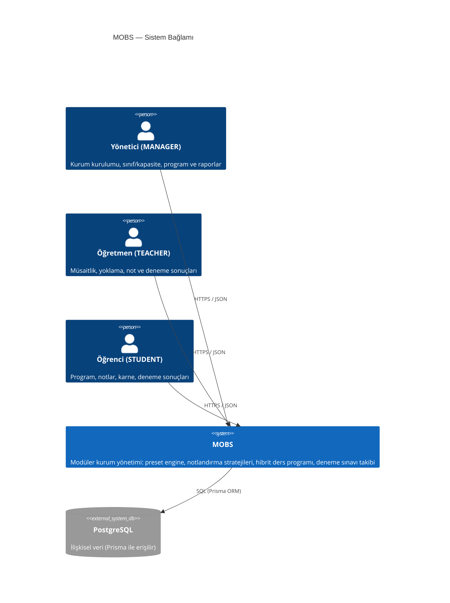
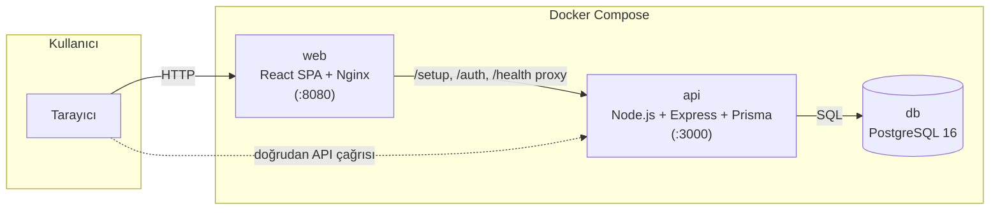
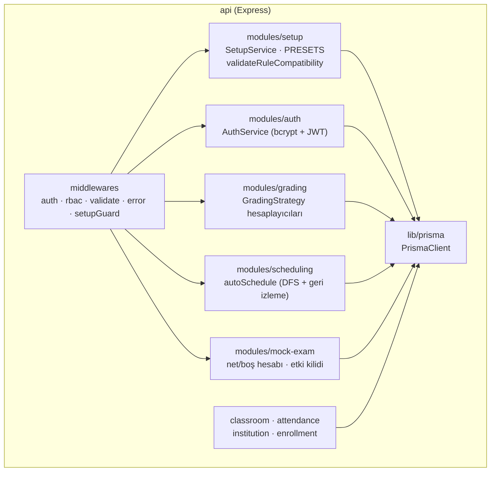
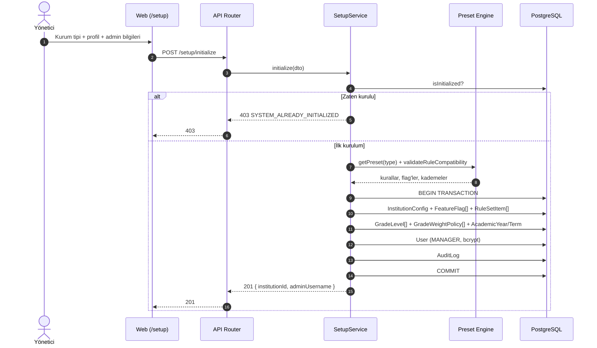
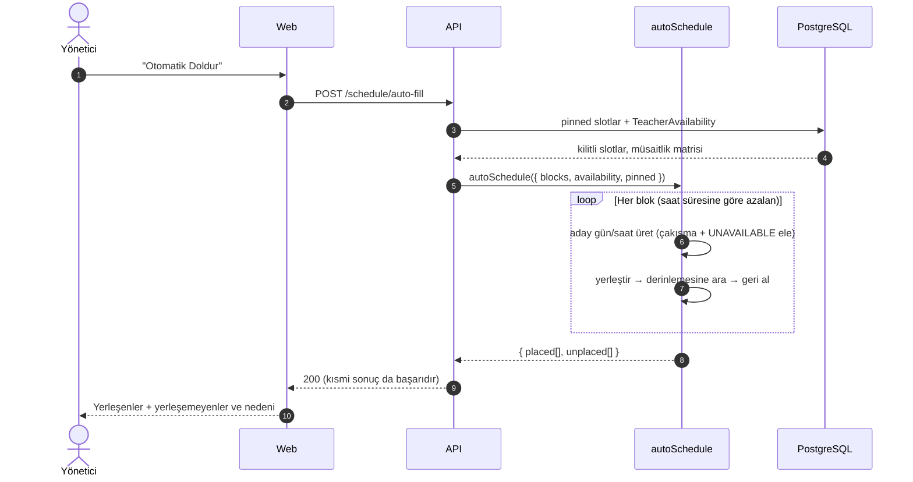
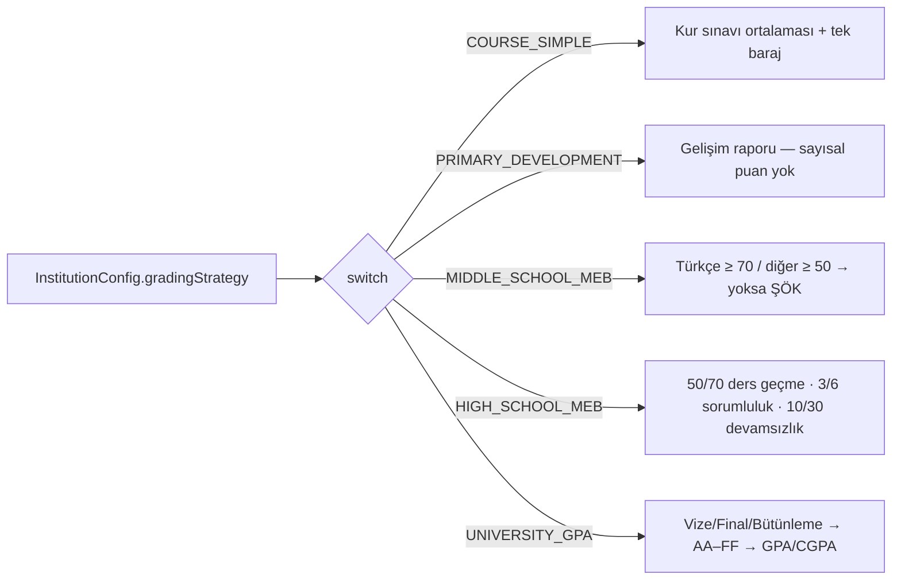

# Sistem Mimarisi — C4 ve Akış Diyagramları

> Kaynak bağlam: [`AI-PROJECT-CONTEXT.md`](../AI-PROJECT-CONTEXT.md) · API sözleşmesi:
> [`openapi.yaml`](../api/openapi.yaml) · Veri modeli: [`api/prisma/schema.prisma`](../../api/prisma/schema.prisma)

## 1. C4 — System Context (Level 1)

## 2. C4 — Container (Level 2)

- **web** — React + Vite + Tailwind; `/setup` sihirbazı, rol bazlı panel, feature flag'e göre dinamik menü.
- **api** — Modüler monolit; preset engine, JWT/RBAC, notlandırma stratejileri, deneme hesabı, ders programı motoru.
- **db** — Tek PostgreSQL; tüm ilişkisel bütünlük Prisma şemasında tanımlı.

## 3. C4 — Component (Level 3, API)

**Modül izolasyonu:** Modüller başka modülün Prisma modeline doğrudan erişmez; servis
arayüzleri (`SetupService`, `AuthService`, …) üzerinden konuşur.

## 4. Sequence — Kurulum (SetupService)

## 5. Sequence — Otomatik Ders Programı

## 6. Notlandırma Stratejisi Seçimi

## 7. Kod → Gereksinim İzlenebilirliği

| Gereksinim | Kod |
| :--- | :--- |
| FR-SETUP-01..05 | `api/src/modules/setup/*`, `middlewares/setupGuard.ts` |
| FR-SCH-01..06 | `api/src/modules/scheduling/scheduler.ts` |
| FR-MOCK-01..05 | `api/src/modules/mock-exam/mock-exam.calc.ts` |
| US-01 (JWT/RBAC) | `api/src/modules/auth/*`, `middlewares/auth.ts`, `middlewares/rbac.ts` |
| US-04 (strateji) | `api/src/modules/grading/grading.strategies.ts` |
| Test senaryoları | `api/src/modules/**/*.test.ts` (46 test) |
